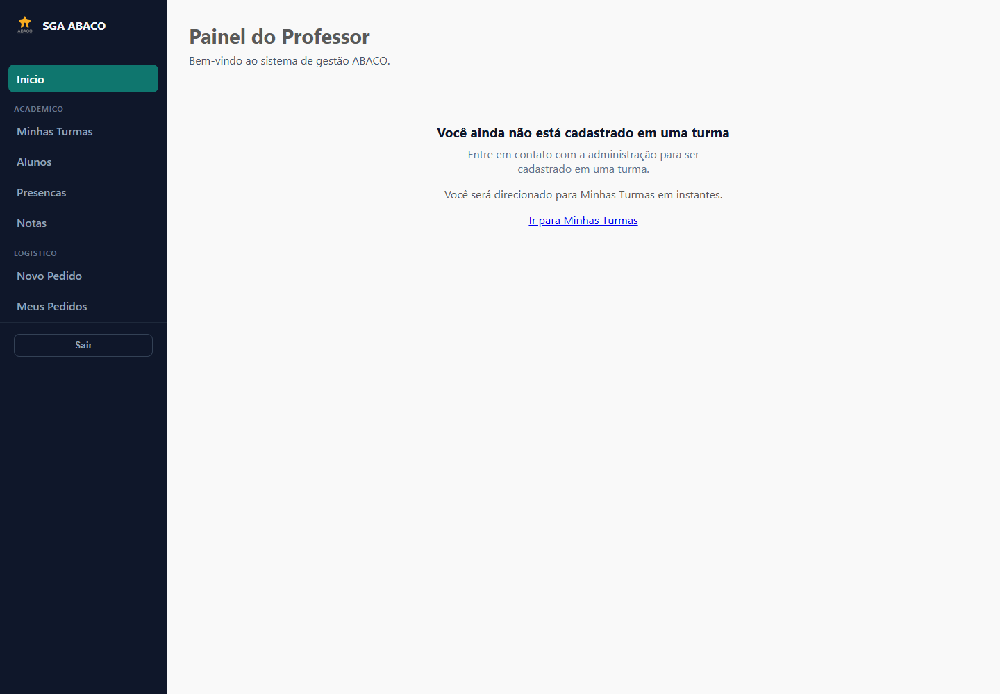
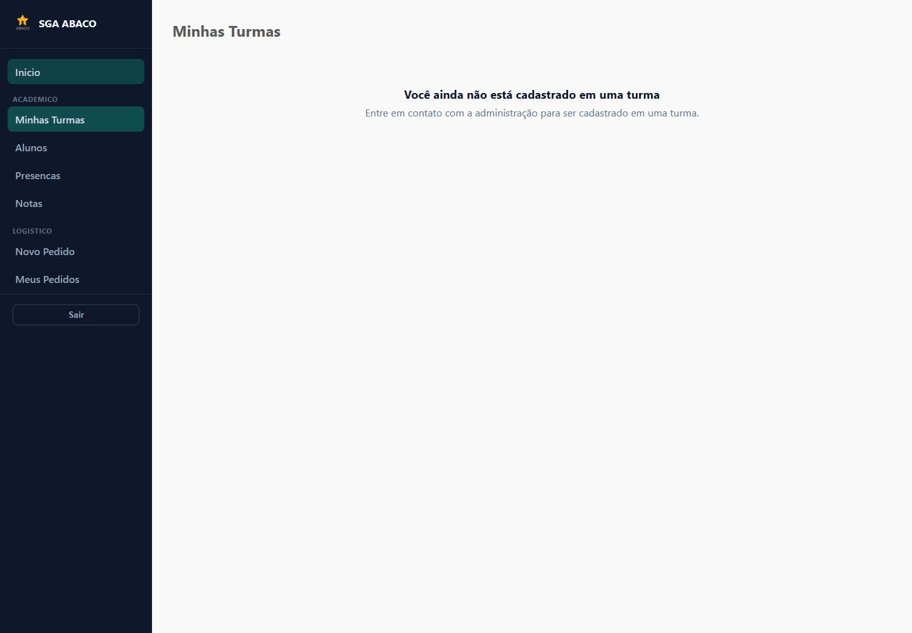
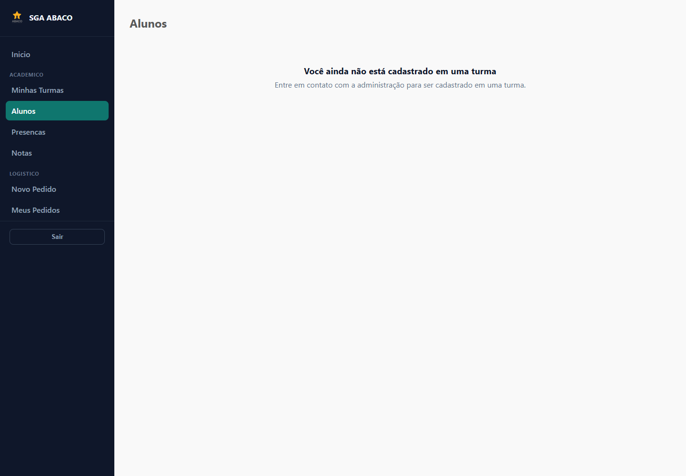
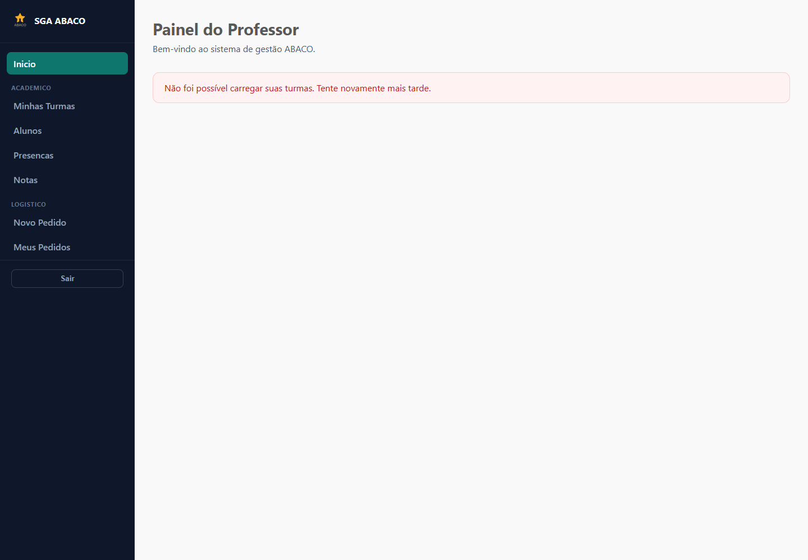
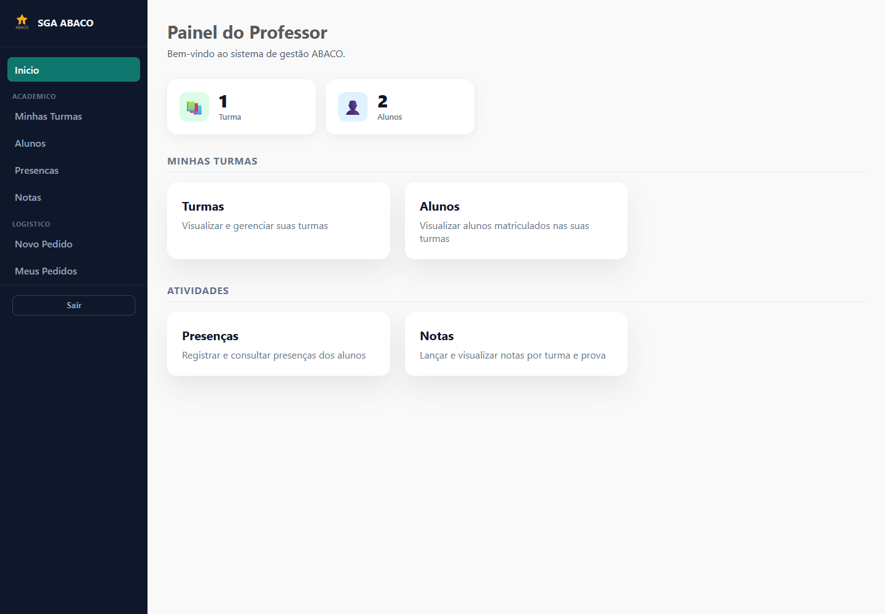
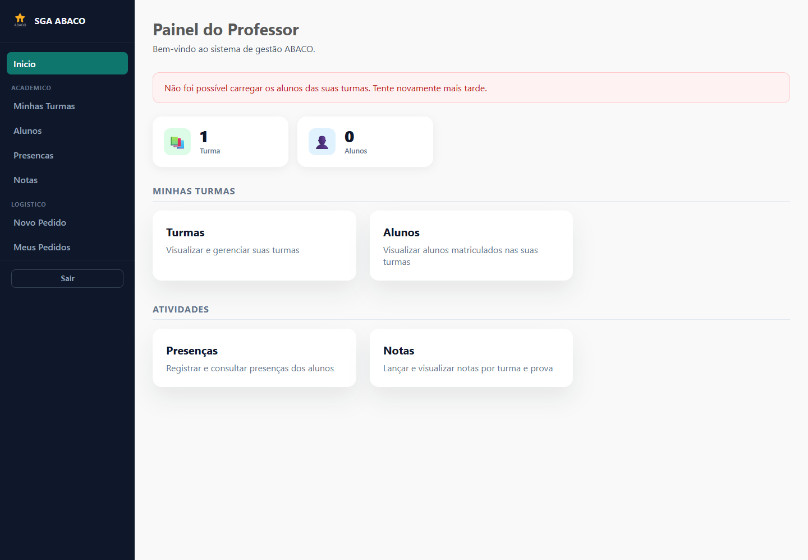
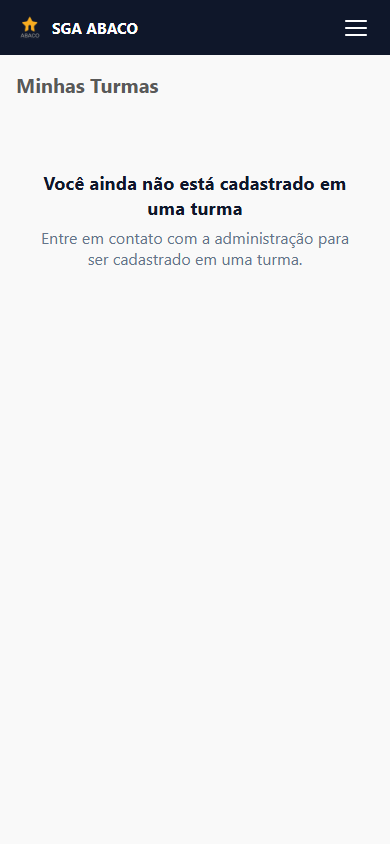

# Validação visual — issue #23 / PR #30

Validação em 09/11/2026, com o build de produção do commit
`a4949a607d442912a03b3967b0f05014f325e4b6`.

Chrome headless 157.0.8103.38, dirigido por Playwright instalado em uma pasta
temporária, sem nova dependência no projeto. Viewports: desktop 1440 × 1000 e
mobile 390 × 844. As sete screenshots foram inspecionadas visualmente.

## Escopo e limites

As respostas de API e a sessão de teste foram simuladas no navegador. Os fluxos
usam os componentes, templates, rotas e guards reais do build. Não foram usados
dados pessoais, credenciais reais, nem alterações no banco. Esta evidência valida
o frontend; não substitui a validação integrada do backend, do login real ou de
permissões no servidor.

## Resultado

**11 cenários aprovados; nenhuma exceção JavaScript de página.** O resultado
estruturado está em [results.json](results.json).

| Cenário | Resultado |
|---|---|
| Professor sem turmas no painel | Mensagem e orientação visíveis; redirecionamento para turmas após 3 segundos, sem loop |
| Alunos sem turmas | Mesma orientação, sem mensagem de erro |
| Link imediato para turmas | Navegação correta; timer anterior não interfere |
| Saída do painel para alunos | Redirecionamento automático cancelado |
| HTTP 500 na consulta de turmas do painel | Alerta de erro; sem onboarding e sem redirecionamento |
| HTTP 500 nas telas de turmas e alunos | Erro separado do estado vazio |
| Professor com turmas | KPIs de 1 turma e 2 alunos, atalhos visíveis, sem redirecionamento |
| Falha na consulta de matrículas | Alerta com turmas e atalhos preservados |
| Turmas sem matrículas | Estado “Nenhum aluno matriculado” |
| Mobile | Orientação legível, sem overflow horizontal |
| Diretor e Admin | Acesso a `/admin/turmas` preservado; área exclusiva de professor redireciona para acesso negado |

## Screenshots

### Painel sem turmas, antes do redirecionamento

### Turmas sem vínculo, após o redirecionamento

### Alunos sem turmas

### Falha simulada da API de turmas

### Professor com turmas

### Falha simulada de matrículas, com atalhos preservados

### Turmas sem vínculo no mobile

